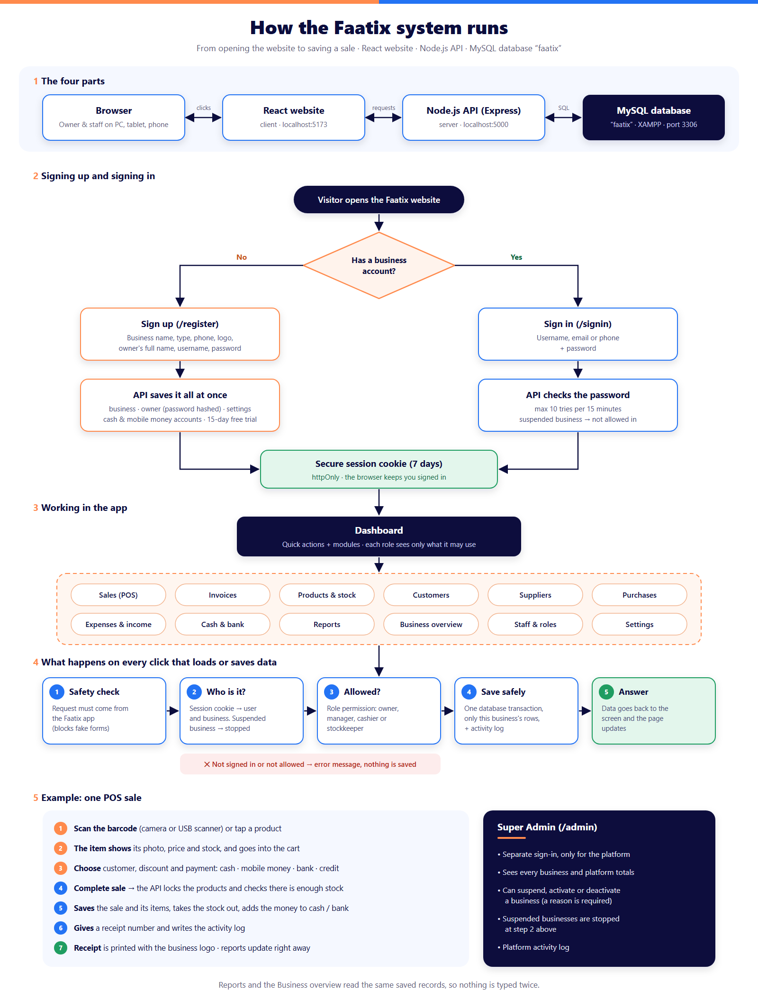

# Faatix — Business System

Faatix is a multi-business management system (Somali & English): a public website plus a
secure business application where each registered business manages only its own data. Built with:

| Part      | Tech                          | Folder       | Runs on                 |
|-----------|-------------------------------|--------------|-------------------------|
| Frontend  | React 18 + Vite + React Router| `client/`    | http://localhost:5173   |
| Backend   | Node.js + Express             | `server/`    | http://localhost:5000   |
| Database  | MySQL (XAMPP)                 | `database/`  | localhost:3306          |

## How it runs



## Requirements

- **Node.js** 18 or newer — https://nodejs.org
- **MySQL** — easiest via **XAMPP** (https://www.apachefriends.org). Only MySQL is needed, not Apache.
- **VS Code** (recommended) to open the folder and use its terminal.

## First-time setup

1. Open the project folder in VS Code and open a terminal (**Terminal → New Terminal**).
2. Install everything:
   ```
   npm run install:all
   ```
3. Create the server settings file (skip if `server/.env` already exists):
   ```
   copy server\.env.example server\.env
   ```
   The defaults match XAMPP (user `root`, no password). Change `DB_PASSWORD` if yours has one.
4. Start MySQL: open the **XAMPP Control Panel** and click **Start** next to **MySQL**.
5. Create the database:
   ```
   npm run db:init
   ```

## Run the project (every day)

1. Start **MySQL** in the XAMPP Control Panel.
2. In the VS Code terminal, from the project folder:
   ```
   npm run dev
   ```
3. Open **http://localhost:5173** in your browser.

`npm run dev` starts both the API (green `[api]` logs) and the website (cyan `[web]` logs).
Stop with **Ctrl + C**.

Check the API and database: http://localhost:5000/api/health

## Production build

```
npm run build     # installs server + client packages, builds client/dist
npm start         # Node serves the API and the built site on http://localhost:5000
```

Locally, `npm run build:client` only rebuilds the website (no reinstall).

## Deploy on Railway

1. **New project → Deploy from GitHub repo** and pick this repository. Railway runs
   `npm ci`, `npm run build` and `npm start` (from `package.json`) — no extra settings needed.
2. **Add a MySQL database** to the same project (**+ New → Database → MySQL**).
3. In the Faatix service open **Variables** and add:
   - `NODE_ENV` = `production`
   - `JWT_SECRET` = a long random text (at least 32 characters) — the app refuses to start without it
   - Database: click **Add Variable Reference** and add `MYSQLHOST`, `MYSQLPORT`, `MYSQLUSER`,
     `MYSQLPASSWORD`, `MYSQLDATABASE` from the MySQL service (or just `MYSQL_URL`).
4. **Settings → Networking → Generate Domain** to get the public https address.
5. Deploy. On the first start the server creates all database tables by itself
   (log line: `Database set up: created all tables`).
6. **Uploaded logos and product photos**: add a **Volume** to the Faatix service mounted at
   `/app/server/uploads`, otherwise uploaded files are lost on every redeploy.

Optional sample data (users from the table below): open a shell inside the running
service with the Railway CLI (`railway ssh`) and run `npm run db:seed`.
On a real business server, change the sample passwords or skip the seed.

## Project structure

```
client/
  public/         favicon.png
  src/
    assets/       faatix-logo.png, faatix-logo-light.png (footer), hero-person.webp
    components/   Header, Footer, Logo, LanguageSwitch, Icon, HeroArt, FeatureGrid, Blob,
                  WhoSection, AboutSection, PricingSection, ContactSection,
                  BuildingArt, StoreArt (illustrations), Layout
    pages/        Home (the whole public site), SignIn, Register, NotFound
    auth/         AuthContext.jsx (signed-in user + business, RequireAuth)
    app/          AppLayout, Dashboard, ModulePage, InvoiceView, ui.jsx, pages/ (one file per module)
    admin/        AdminApp.jsx (Super Admin panel)
    config/       site.js (contact phones/emails, optional section photos)
    i18n/         translations.js (all EN/SO text), LanguageContext.jsx
    services/     api.js, authService.js (register, sign-in, sign-out)
    hooks/        usePageTitle, useReveal, useActiveSection (menu highlight)
    styles/       styles.css (public site), app.css + modules.css (business app)
server/
  src/
    config/       env.js, db.js (MySQL pool)
    middleware/   auth.js (session check, roles, audit log)
    routes/       auth, dashboard, products, sales, invoices, purchases, parties, money, reports, account, admin
    scripts/      initDb.js, seedSample.js
database/
  schema.sql      creates the `faatix` database with all tables (safe to re-run)
server/uploads/   uploaded business logos (not committed to git)
static-version/   the earlier (green) plain-HTML version, kept for reference
```

## How the site is organised

The public website is **one page** (`/`): Hero, Features, Who Can Use, About, Pricing and
Contact. The menu items scroll to those sections (`/#features`, `/#who`, `/#about`,
`/#pricing`, `/#contact`).
**Sign up** (`/register`) and **Sign in** (`/signin`) are separate pages. After signing in,
the business application lives under `/app`.

The hero slogan uses **Saira**, section names use **Kanit**, the menu uses **Kanit**, and body text uses **Outfit**
(all from Google Fonts).

## Changing images

- Logo: replace `client/src/assets/faatix-logo.png` and the white-text
  `faatix-logo-light.png` (used on navy backgrounds).
- Hero photo: replace `client/src/assets/hero-person.webp` (transparent background).
  Its size is set by `.hero-figure` in `styles.css`; the floating card is positioned
  as percentages of the photo (`.chip--invoice`) so it stays on his shoulder.
- Business photos (Who can use Faatix?): `client/public/images/who/biz-1.webp` … `biz-12.webp`,
  numbered in the same order as the list (1 = Supermarkets … 12 = Service businesses).
- Building photos (About, Get in touch): `client/public/images/about-building.webp` and
  `contact-building.webp` (mockups with the Faatix sign). Paths are set in
  `client/src/config/site.js`; set one to `null` to show the drawn illustration instead.

## Placeholders to fill in

- Phone numbers and emails: `client/src/config/site.js`.
- Footer links "What's new", "Help center", "Privacy policy", "Terms of service".

## Editing text and translations

All text lives in `client/src/i18n/translations.js` under `en` and `so`.
The chosen language is remembered in the browser; `?lang=so` in a URL forces Somali.

## Business application (what works now)

- **Registration** (`/register`): business details, optional logo (PNG/JPG/WEBP, max 2 MB,
  checked on the server), owner account. Saved in one database transaction: business, owner
  user (password hashed with bcrypt), owner role, settings, a default cash account and a
  15-day trial record.
- **Sign in** with username, email or phone. Sessions are an httpOnly, SameSite=Strict cookie
  (7 days). Login attempts are rate-limited (10 per 15 minutes).
- **Data isolation**: every business query filters by the signed-in user's `business_id` on
  the server. Asking for another business's record returns "not found".
- **Dashboard** (`/app`): totals for today / this week / this month / this year / custom dates,
  calculated from real records only (empty states when there is no data). Definitions are
  documented at the top of `server/src/routes/dashboard.js`.
- **Invoices**: `/app/invoices/:id` shows a printable invoice (Print / Save as PDF) with the
  Faatix logo in the header and "Powered by Faatix" in the footer, plus the business logo and
  details. `/app/invoices/preview` shows the layout with clearly-marked sample lines.
- **Somali / English** across the whole app; the choice is saved on the user's account.

## Modules

| Module | Where | Notes |
|---|---|---|
| POS | `/app/m/pos` | Barcode search (Enter), cart, discount, cash / mobile money / bank / credit, change, printable receipt with the Faatix logo, cancel & refund |
| Invoices | `/app/m/invoices`, `/app/invoices/new` | Retail or wholesale prices, due dates, partial payments, overdue status, cancel (unpaid only) |
| Products & stock | `/app/m/products` | Categories, units, barcodes, low-stock alerts, stock adjustments with a reason, movement history, CSV import/export |
| Customers / Suppliers | `/app/m/customers`, `/app/m/suppliers` | Balances, statements, payments (allocated oldest-first) |
| Purchases | `/app/m/purchases` | Receive stock, updates cost price, supplier payments |
| Expenses & income | `/app/m/expenses` | Categories, totals by category |
| Cash & bank | `/app/m/cash` | Cash, mobile money and bank accounts, transfers, cashbook |
| Reports | `/app/m/reports` | Sales, profit, inventory, low stock, receivables, payables, purchases, expenses, cash flow, best sellers (CSV + print) |
| Staff & roles | `/app/m/staff` | Owner, manager, cashier, stockkeeper (permissions enforced on the server) |
| Settings, business info, profile, subscription, activity log | `/app/m/...` | Logo, currency, invoice prefix/footer, language |
| Notifications | bell in the top bar | Low/out of stock, invoices due/overdue, supplier balances |
| Super Admin | `/admin` | Platform overview, all businesses, suspend / activate with a reason, platform audit log |

## Sample data and users

```
npm run db:seed            # adds the sample business (safe to re-run)
npm run db:seed -- --reset # deletes and recreates the sample business
```

Database name: **`faatix`**. The sample business is "Hodan Supermarket (SAMPLE)".

| Role | Username | Password | Sign in at |
|---|---|---|---|
| Owner | `hodan` | `Faatix@2026` | `/signin` |
| Manager | `manager1` | `Manager@2026` | `/signin` |
| Cashier | `cashier1` | `Cashier@2026` | `/signin` |
| Stockkeeper | `stock1` | `Stock@2026` | `/signin` |
| Super Admin | `superadmin` | `Admin@2026` | `/admin/signin` |

Change these passwords (or don't run the seed) on any real server.

## Not built yet

Partial returns (only whole-sale cancellation), payment plans, password reset by email,
online subscription payments, and deployment documentation. The Somali text should be
reviewed by a native speaker.
